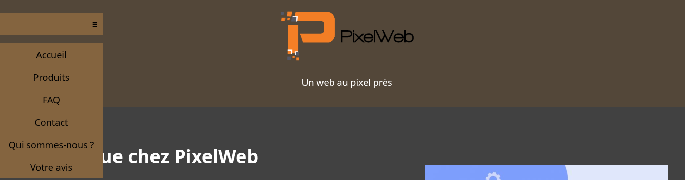
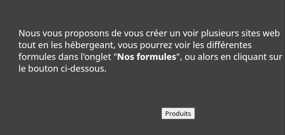
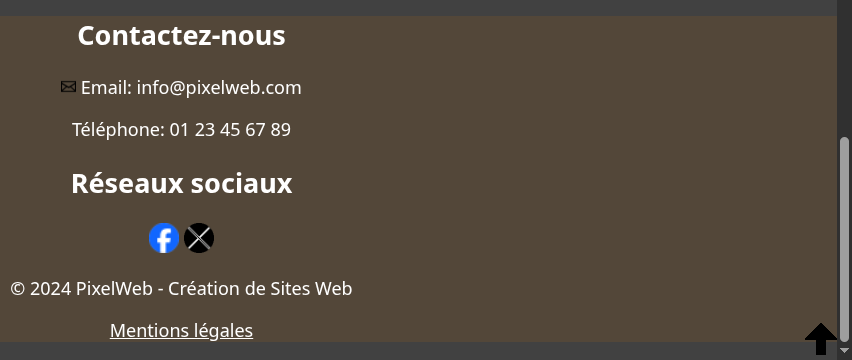
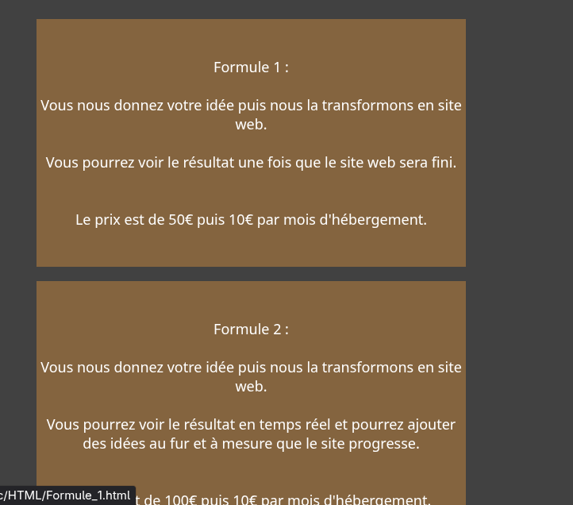
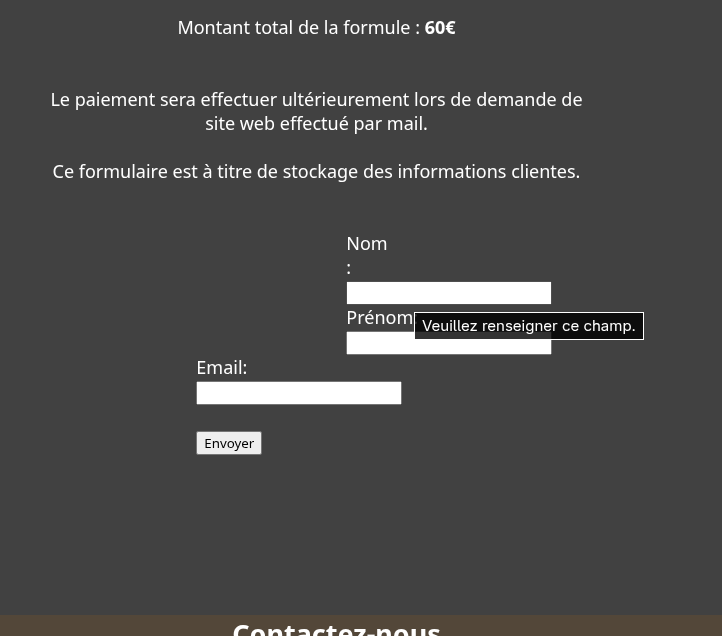
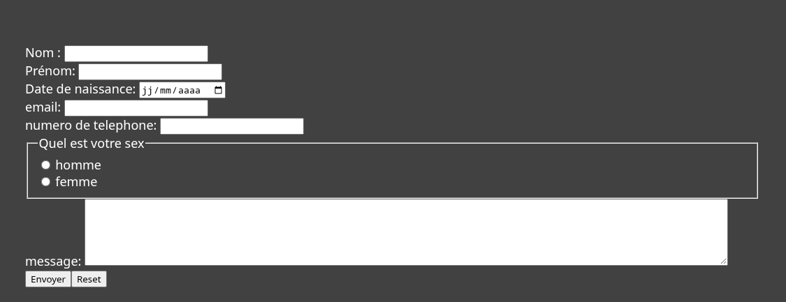
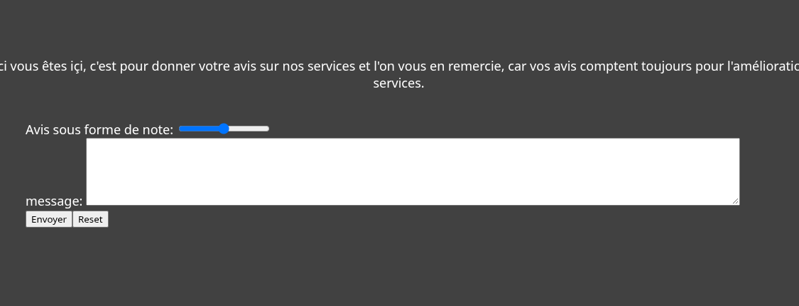

# Projet BUT1 EGOD & EC & DEV -- PIXELWEB --

### Présentation

Ce projet a été réalisé lors de ma première année de BUT en 2023-2024, il s'agit d'un site web où l'on devait avoir une collaboration entre 3 matière : EGOD (), EC (Expression Communication), DEV (Développement WEB).

### Contrainte

Nous devions travailler en groupe de deux ou trois personnes pour créer un site web pour une entreprise fictive en utilisant les connaissances reçus en EGOD (planification d'entreprise) et EC (pagination de site web et visuel).

### Durée

Le projet a durée du 21 décembre 2023 au 19 janvier 2024 donc 29 jours, donc 4 semaines.

## Les membres du projet

Les membres participant a ce projet était :
- KHADIR Soraya
- ABRAHAM Ozvann

## Aperçu du projet en 2023-2024

    

        
        
        
        
        
        
        

        
        
        
        
        
        
        
    

## Aperçus du projet actuel
